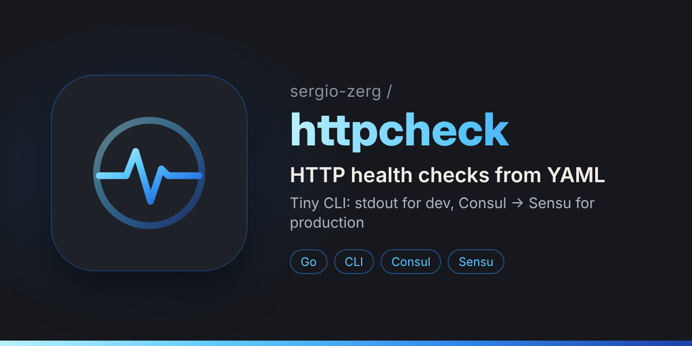

[English](README.md) | **Русский**

<p align="center"></p>

# httpcheck

[](https://github.com/sergio-zerg/httpcheck/actions/workflows/ci.yml)
[](https://pkg.go.dev/github.com/sergio-zerg/httpcheck)
[](https://goreportcard.com/report/github.com/sergio-zerg/httpcheck)

[](LICENSE)

Небольшая консольная утилита: выполняет HTTP-проверки, описанные в YAML, и сообщает
результат — в **stdout** для локальной работы или в API результатов **Sensu**
(описания проверок берутся из **Consul KV**) для системы мониторинга.

> Учебный проект: компактная утилита на Go почти без зависимостей — аккуратный пример
> CLI с режимом «файл → stdout» для разработки и «Consul → Sensu» для продакшена.
> Написана в 2017 году, обновлена в 2026 (Go modules, свежие библиотеки, тесты, CI).
> Что дальше — [роадмап](ROADMAP.ru.md).

## Что делает

Для каждой именованной проверки отправляет HTTP(S)-запрос на каждую цель `протокол × домен`
и проверяет, что задано в настройках:

- **status** — код ответа HTTP совпадает с `status`;
- **format** — `Content-Type` совпадает с `format` (`text` / `json` / `xml` / `yaml`), и тело разбирается как этот тип;
- **response** — тело в точности равно `response`.

По каждой цели — либо один результат `All OK`, либо по результату на каждую неудачную
проверку, с длительностью запроса. Проверки идут параллельно.

## Установка

```sh
go install github.com/sergio-zerg/httpcheck@latest
```

Или сборка из исходников:

```sh
git clone https://github.com/sergio-zerg/httpcheck.git
cd httpcheck
make build      # собирает ./bin/httpcheck со сведениями о версии
```

## Запуск

```sh
# dev: проверки из файла, результаты в stdout
httpcheck --env dev --config checks.yaml --log-level info

# prod: проверки из Consul KV, результаты в API Sensu
httpcheck --env prod --consul-api http://consul:8500 --sensu-api http://sensu:4567
```

| Флаг | Переменная | По умолчанию | Значение |
|------|------------|--------------|----------|
| `--env, -e` | `HTTPCHECK_ENV` | `dev` | `dev` (файл → stdout) или `prod` (Consul → Sensu) |
| `--config, -f` | `HTTPCHECK_CONFIG` | `checks.yaml` | файл проверок (dev) |
| `--consul-api, -c` | `HTTPCHECK_CONSUL_API` | `http://consul-api:8500` | базовый адрес API Consul (prod) |
| `--sensu-api, -s` | `HTTPCHECK_SENSU_API` | `http://sensu-api:4567` | базовый адрес API результатов Sensu (prod) |
| `--ip, -i` | `HTTPCHECK_IP` | — | подменить заголовок `Host` / источник для всех проверок |
| `--log-level, -l` | `HTTPCHECK_LOG_LEVEL` | `warning` | `debug` / `info` / `warning` / `error` / `fatal` / `panic` |

## Формат файла проверок

```yaml
homepage:                     # имя проверки
  protocols: [http, https]    # по умолчанию [http]
  domains: [example.com]      # один или несколько хостов (host[:port])
  path: /
  method: GET                 # по умолчанию GET
  status: 200                 # необязательно: ожидаемый код ответа
  format: text                # необязательно: text | json | xml | yaml
  response: ""                # необязательно: ожидаемое тело целиком
  timeout: 10                 # необязательно: таймаут проверки в секундах (по умолчанию 30)
  headers:
    X-Env: prod
  auth:                       # необязательно: HTTP basic auth
    username: user
    password: pass
```

Рабочий пример — [`checks.yaml`](checks.yaml).

## Разработка

```sh
make test       # go test с детектором гонок и покрытием
make lint       # golangci-lint
make vuln       # govulncheck
make ci         # fmt-check + vet + lint + test + build
```

## Устройство

```
main.go              подключение CLI (urfave/cli)
internal/config      разбор проверок, запросы, проверка результатов
internal/engine      вход (файл/Consul) и выход (stdout/Sensu), параллельность
internal/result      итог одной проверки
internal/sensu       тело запроса к API результатов Sensu
```

## Лицензия

[MIT](LICENSE)
